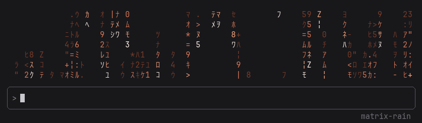

# claude-wait-spinner

Claude Code mods that animate the band above the prompt while Claude is working on a turn.
The animation disappears as soon as the turn ends, and picks up again after a question or
permission dialog. Terminal only; desktop, VS Code and mobile are left as they are.
No settings, no network, no files: each spinner is one hooks module.

Each spinner draws its own row, so install one at a time (`iterm-tab-colors` below combines
with either):

```
/plugin install <spinner> --marketplace gerzha/claude-wait-spinner
```

Answer `y` to add the marketplace, then pick a scope (user scope keeps it in every session).

## `matrix-rain`

Matrix-style katakana rain in Claude orange, up to 7 rows high, as wide as the prompt.



## `pulse-monitor`

A heart monitor: a phosphor-green trace sweeps across in braille dots. Every tool call Claude
makes fires an extra beat and quickens the pulse; the readout shows the BPM and the last tool.


## `iterm-tab-colors`

Not a spinner, so it goes along with either of them. For iTerm2 3.7+ on macOS: while Claude
is working, iTerm2 draws a progress ring around the tab, and this plugin gives every Claude
session its own ring colour, so a sidebar full of busy tabs tells them apart at a glance.

On session start a hook picks a colour that no other running Claude tab holds (blue, orange,
purple, cyan, yellow, red, green, then rainbow) and switches the tab to the matching
`Claude <Colour>` profile. A tab keeps its colour across `/clear`, resume and restarts of
Claude in it; the colour is freed once no Claude runs in that tab. Switching the profile
resets the tab title, so the hook sends the session title again right after.

Set up iTerm2 once:

- Settings → Appearance → General → Theme: Regular, Light or Dark. Only these tab styles draw
  the ring; Minimal and Compact draw a thin line instead.
- Settings → Advanced: "Prevent control sequences from changing the current profile?" → No.
- Keep Claude Code's "Terminal progress bar" on in `/config` (it is on by default).

On first run the hook copies `claude-progress-colors.json` into
`~/Library/Application Support/iTerm2/DynamicProfiles/`: eight profiles that inherit from your
profile named `Default` and change only the ring colour. Tabs on any other profile (a hotkey
window, an ssh profile) are left alone. Edit the installed file to restyle; delete it to get
the stock one back. The colour each tab holds is kept in `~/.claude/state/iterm-tab-colors/`.

To colour a tab where Claude is already running, pass its tty (and optionally the transcript,
for the title):

```sh
bash plugins/iterm-tab-colors/hooks/iterm-tab-color.sh ttys003 ~/.claude/projects/<project>/<session>.jsonl
```

## Develop

Run a spinner from a checkout without installing:

```sh
claude --plugin-dir /path/to/claude-wait-spinner/plugins/<spinner>
```

or set `CLAUDE_CODE_PLUGIN_DIRS` to that folder in the `env` block of `~/.claude/settings.json`.
Saving `hooks/register.ts` hot-reloads the mod in a running session.

The demos are rendered from the real hooks modules, driven by a stand-in engine on a virtual
clock. The same run checks that the band animates, resumes after a dialog and stops when the
turn ends:

```sh
npx tsx tools/capture.mts plugins/<spinner>/hooks/register.ts /tmp/frames.json 120 80 7
uv run --with pillow python tools/render_gif.py /tmp/frames.json docs/<spinner>.gif <spinner>
```

`render_gif.py` uses macOS font paths (JetBrains Mono Nerd Font, Hiragino for katakana);
override them with `TEXT_FONT` and `KANA_FONT`.
