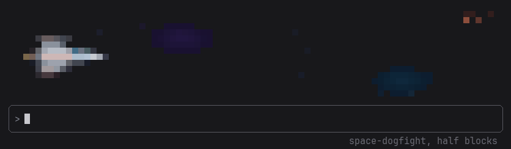
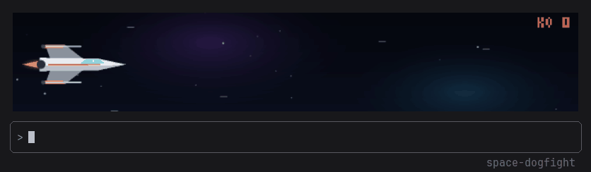
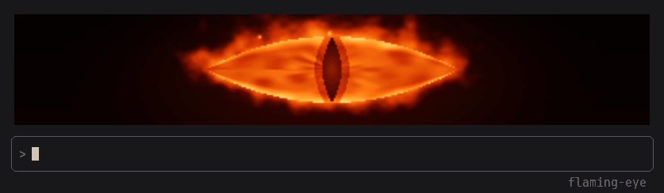
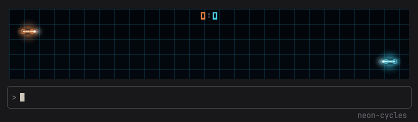
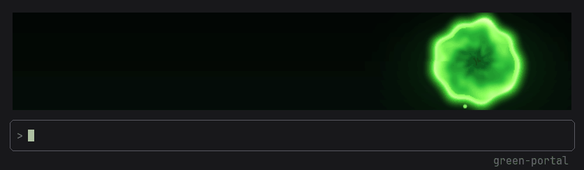

# claude-wait-spinner

Claude Code mods that animate the band above the prompt while Claude is working on a turn.
The animation disappears as soon as the turn ends, and picks up again after a question or
permission dialog. Terminal only; desktop, VS Code and mobile are left as they are.
No settings, no network, no files: each spinner is one hooks module.

Each spinner draws its own row, so install one at a time:

```
/plugin install <spinner> --marketplace gerzha/claude-wait-spinner
```

Answer `y` to add the marketplace, then pick a scope (user scope keeps it in every session).

## Picture spinners

These paint real pixels where the terminal can show pictures: kitty, Ghostty, or iTerm2 3.5+
with Claude Code's fullscreen rendering (`"tui": "fullscreen"`). Anywhere else the same frames
are drawn in half blocks, automatically:

<details><summary>space-dogfight in half blocks</summary>



</details>

### `space-dogfight`

A rebel starfighter in Claude-orange stripes shoots down enemy interceptors weaving in over a
scrolling starfield and nebulae; they shoot back and its shield flares. Kills are counted top right.



### `flaming-eye`

A lidless eye wreathed in flame. Its slit pupil wanders; every tool call Claude makes flares the
fire, narrows the pupil and snaps the gaze somewhere new. Embers drift up from the blaze.



### `neon-cycles`

Two light cycles race on a neon grid, Claude orange against cyan, each leaving a wall of light.
Whoever runs into a wall derezzes; the score is kept top centre and the arena clears for the next round.



### `green-portal`

A swirling green portal. Every tool call Claude makes comes flying out of it by name, growing as it
nears; the portal pulses and spits goo.



## Text spinners

Drawn in terminal characters everywhere.

### `matrix-rain`

Matrix-style katakana rain in Claude orange, up to 7 rows high, as wide as the prompt.


### `pulse-monitor`

A heart monitor: a phosphor-green trace sweeps across in braille dots. Every tool call Claude
makes fires an extra beat and quickens the pulse; the readout shows the BPM and the last tool.


## Develop

Run a spinner from a checkout without installing:

```sh
claude --plugin-dir /path/to/claude-wait-spinner/plugins/<spinner>
```

or set `CLAUDE_CODE_PLUGIN_DIRS` to that folder in the `env` block of `~/.claude/settings.json`.
Saving `hooks/register.ts` hot-reloads the mod in a running session.

The picture spinners share `shared/kit.ts` (drawing, encoding, the band's life cycle); each plugin
carries a copy as `hooks/kit.ts`, since a plugin must stand alone. Edit the shared file, then:

```sh
node tools/sync-kit.mjs
```

The demos are rendered from the real hooks modules, driven by a stand-in engine on a virtual
clock. The same run checks that the band animates, resumes after a dialog, stops when the turn
ends, falls back to half blocks where pictures are refused (`--no-pictures`), and reports the
time a frame takes:

```sh
npx tsx tools/capture.mts plugins/<spinner>/hooks/register.ts /tmp/frames.json 120 80 7 [--no-pictures]
uv run --with pillow python tools/render_gif.py /tmp/frames.json docs/<spinner>.gif <spinner>
```

`render_gif.py` uses macOS font paths (JetBrains Mono Nerd Font, Hiragino for katakana);
override them with `TEXT_FONT` and `KANA_FONT`.
