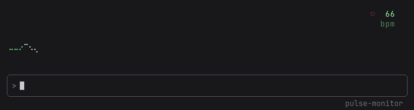

# claude-wait-spinner

Claude Code mods that animate the band above the prompt while Claude is working on a turn.
The animation disappears as soon as the turn ends, and picks up again after a question or
permission dialog. Terminal only; desktop, VS Code and mobile are left as they are.
No settings, no network, no files: each spinner is one hooks module.

Each spinner draws its own row, so install one at a time:

```
/plugin install <spinner> --marketplace gerzha/claude-wait-spinner
```

Answer `y` to add the marketplace, then pick a scope (user scope keeps it in every session).

## `matrix-rain`

Matrix-style katakana rain in Claude orange, up to 7 rows high, as wide as the prompt.


## `pulse-monitor`

A heart monitor: a phosphor-green trace sweeps across in braille dots. Every tool call Claude
makes fires an extra beat and quickens the pulse; the readout shows the BPM and the last tool.



## Develop

Run a spinner from a checkout without installing:

```sh
claude --plugin-dir /path/to/claude-wait-spinner/plugins/<spinner>
```

or set `CLAUDE_CODE_PLUGIN_DIRS` to that folder in the `env` block of `~/.claude/settings.json`.
Saving `hooks/register.ts` hot-reloads the mod in a running session.

The demos are rendered from the real hooks modules, driven by a stand-in engine on a virtual
clock. The same run checks that the band animates, resumes after a dialog and stops when the
turn ends:

```sh
npx tsx tools/capture.mts plugins/<spinner>/hooks/register.ts /tmp/frames.json 120 80 7
uv run --with pillow python tools/render_gif.py /tmp/frames.json docs/<spinner>.gif <spinner>
```

`render_gif.py` uses macOS font paths (JetBrains Mono Nerd Font, Hiragino for katakana);
override them with `TEXT_FONT` and `KANA_FONT`.
